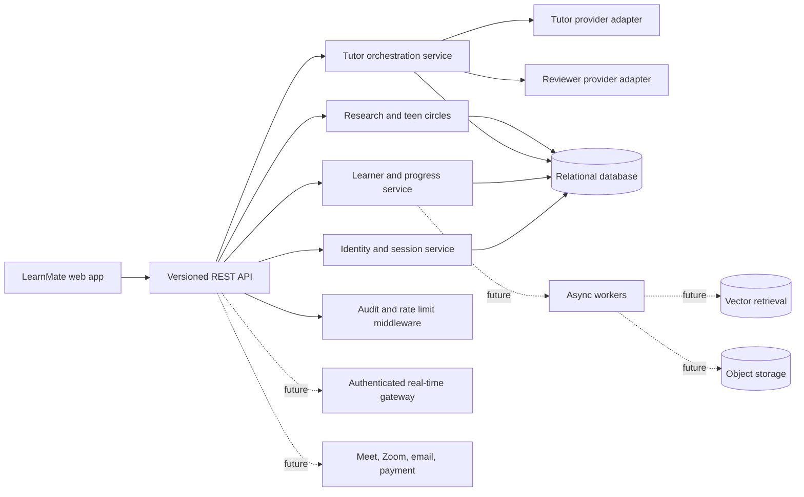
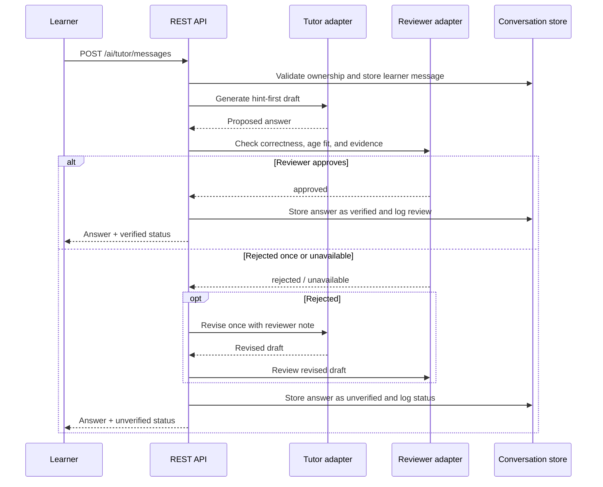
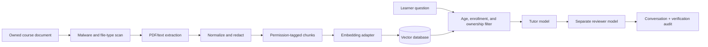

# LearnMate AI — Architecture and Delivery Roadmap

## 1. Architecture decisions

This implementation picks a small local stack because the supplied prompt left all framework and infrastructure placeholders open:

| Concern | First version | Replaceable target |
|---|---|---|
| HTTP API | Python standard-library threaded HTTP server | ASGI framework behind the same service modules |
| Database | SQLite with numbered SQL migrations | PostgreSQL for multi-instance operation |
| Authentication | PBKDF2-SHA256 passwords, signed HS256 access/refresh tokens | Managed identity or OAuth adapters |
| Web client | Static HTML, CSS, and JavaScript | Independent frontend deployment |
| AI | Mock provider by default; OpenAI-compatible adapter | Provider interface for LLM and reviewer |
| Jobs, cache, vectors, files | Interfaces and relational records only | Queue, cache, vector store, and object storage adapters |

The local server is intentionally single-node. SQLite, in-memory rate limits, and a threaded HTTP server are not presented as a horizontally scalable production topology.

## 2. Component diagram

## 3. Tutor and reviewer sequence

The mock tutor is deliberately not an answer verifier. The browser and API preserve `unverified` status unless a configured reviewer model explicitly approves the response. The API currently supplies no trusted course excerpts to the reviewer; course-aware RAG is a later step.

## 4. Data model and ER diagram

The initial migration creates normalized relational tables across all requested domains. The app actively reads and writes identity, learner profiles, courses, lessons, enrollments, lesson completions, goals, study sessions, AI conversations/messages/review logs, daily activity, audit records, research articles and per-learner reading events/preferences, curiosity question/solution history, and teen room messages/reports. Other ESD domain tables remain groundwork without public workflows.

```mermaid
erDiagram
  USERS ||--o| LEARNER_PROFILES : has
  USERS ||--o{ SESSIONS : opens
  USERS ||--o{ CONSENT_RECORDS : grants
  USERS ||--o{ GUARDIAN_RELATIONSHIPS : guardian_or_learner
  SUBJECTS ||--o{ COURSES : groups
  COURSES ||--o{ LESSONS : contains
  USERS ||--o{ COURSE_ENROLLMENTS : enrolls
  COURSES ||--o{ COURSE_ENROLLMENTS : has_learners
  LESSONS ||--o{ LESSON_COMPLETIONS : tracks
  USERS ||--o{ LESSON_COMPLETIONS : completes
  USERS ||--o{ LEARNING_GOALS : sets
  USERS ||--o{ STUDY_SESSIONS : focuses
  USERS ||--o{ AI_CONVERSATIONS : owns
  AI_CONVERSATIONS ||--o{ AI_MESSAGES : contains
  AI_MESSAGES ||--o{ AI_VERIFICATION_LOGS : reviewed_by
  USERS ||--o| CURIOSITY_PREFERENCES : configures
  USERS ||--o{ RESEARCH_ARTICLE_EVENTS : reads_or_saves
  RESEARCH_ARTICLES ||--o{ RESEARCH_ARTICLE_EVENTS : tracks
  USERS ||--o{ CURIOSITY_QUESTIONS : asks
  RESEARCH_ARTICLES ||--o{ CURIOSITY_QUESTIONS : inspires
  CURIOSITY_ROOMS ||--o{ CURIOSITY_ROOM_MESSAGES : hosts
  USERS ||--o{ CURIOSITY_ROOM_MESSAGES : writes
  CURIOSITY_ROOM_MESSAGES ||--o{ CURIOSITY_MESSAGE_REPORTS : reported
  ASSESSMENTS ||--o{ QUESTIONS : contains
  USERS ||--o{ QUIZ_ATTEMPTS : takes
  ASSESSMENTS ||--o{ QUIZ_ATTEMPTS : attempted
  QUIZ_ATTEMPTS ||--o{ QUIZ_RESPONSES : records
  USERS ||--o{ COMMUNITY_MEMBERSHIPS : joins
  COMMUNITIES ||--o{ COMMUNITY_MEMBERSHIPS : has
  COMMUNITIES ||--o{ DISCUSSIONS : hosts
  LIVE_SESSIONS ||--o{ ATTENDANCE_RECORDS : records
  LIVE_SESSIONS ||--o{ TRANSCRIPTS : produces
  TRANSCRIPTS ||--o{ GENERATED_SUMMARIES : summarizes
  USERS ||--o{ CERTIFICATES : earns
  USERS ||--o{ PROJECTS : creates
  USERS ||--o{ MARKETPLACE_LISTINGS : sells
  MARKETPLACE_LISTINGS ||--o{ TRANSACTIONS : purchased
  USERS ||--o{ NOTIFICATIONS : receives
  USERS ||--o{ AUDIT_LOGS : acts
```

`migrations/001_initial.sql` and `migrations/002_curiosity.sql` define foreign keys, cascade behavior for user-owned records, uniqueness constraints, role/state checks, and indexes for sessions, goals, conversations, reading events, curiosity history, room messages, and audit lookup. Curiosity question text and generated answers are retained against the learner account. Data retention and deletion workflows are not yet implemented; define them before production use.

## 5. Authentication and permission matrix

| Capability | Learner | Parent/guardian | Educator | Mentor | Moderator | Admin |
|---|---:|---:|---:|---:|---:|---:|
| Public registration | Yes | Not yet | No | No | No | No |
| Read own learner profile | Yes | No | No | No | No | Operational access only |
| Own courses, goals, focus, tutor | Yes | No | No | No | No | Operational access only |
| Curiosity questions and preferences | Own records | No | No | No | No | Operational access only |
| Teen room messages | Teen accounts only; visible to signed-in teen learners | No | No | No | No | Operational access only |
| Link child / grant consent | Not yet | Not yet | — | — | — | Not yet |
| Manage classes / assignments | — | — | Not yet | — | — | Not yet |
| Moderate reports | — | — | — | — | Not yet | Not yet |

Role escalation is blocked at public registration. Educator, mentor, moderator, and admin accounts require an administrative provisioning path that is not part of this MVP. Each implemented learner resource is scoped to the authenticated learner ID. Public signup blocks toddler and child age brackets until consent is available. This is a conservative product gate, not a complete child privacy workflow.

The Curiosity community's age gate uses the account's self-selected teen/adult bracket and is not identity- or age-verified. Reported posts are hidden from other learners; messages containing detected email addresses or phone-like strings are held from the room. This is a basic quarantine, not a moderation queue or staffed response workflow. The preference toggle for recommendations starts off; enabled suggestions use that same learner's article activity and article-specific answer feedback. No cross-user profiling or shared-model training is implemented.

Access tokens are short-lived and signed. Refresh tokens are stored only as SHA-256 digests in `sessions`, rotated on use, and revoked on sign-out. The browser keeps tokens in `sessionStorage`. The app uses local HTTP for development; a deployment must terminate TLS in front of it.

## 6. REST API specification

Base path: `/api/v1`. Responses use `{ "data": ..., "meta": ... }`; errors use `{ "error": { "code": ..., "message": ... } }`. Authenticated routes require `Authorization: Bearer <access_token>`.

| Method | Path | Access | State |
|---|---|---|---|
| GET | `/health` | Public | Implemented |
| POST | `/auth/register` | Public | Implemented; learner role, teen/adult only |
| POST | `/auth/login` | Public | Implemented |
| POST | `/auth/refresh` | Refresh token | Implemented with rotation |
| POST | `/auth/logout` | Signed-in user | Implemented; revokes current session |
| GET | `/auth/me` | Signed-in user | Implemented |
| GET, PATCH | `/learners/me` | Learner | Implemented |
| GET | `/analytics/overview` | Learner | Implemented; weekly summary |
| GET | `/courses` | Signed-in user | Implemented; age-filtered catalog |
| POST | `/courses/{course_id}/enroll` | Learner | Implemented; idempotent enrollment |
| GET | `/courses/{course_id}/lessons` | Enrolled learner | Implemented |
| POST | `/lessons/{lesson_id}/complete` | Enrolled learner | Implemented; awards XP once |
| GET, POST | `/goals` | Learner | Implemented |
| PATCH | `/goals/{goal_id}` | Goal owner | Implemented; completion toggle |
| POST | `/focus/sessions` | Learner | Implemented |
| PATCH | `/focus/sessions/{session_id}` | Session owner | Implemented |
| POST | `/ai/tutor/messages` | Learner | Implemented; verification status included |
| GET | `/curiosity/articles` | Public; saved state when signed in | Implemented; catalog seeded from cited research |
| POST | `/curiosity/articles/{article_id}/events` | Learner | Implemented; view/save/unsave |
| GET, PATCH | `/curiosity/preferences` | Learner | Implemented; personal recommendations default off |
| GET, POST | `/curiosity/questions` | Learner | Implemented; asks, history, and solution deck |
| POST | `/curiosity/questions/{question_id}/feedback` | Question owner | Implemented |
| GET | `/communities/rooms` | Public; age-filtered when signed in | Implemented |
| GET, POST | `/communities/rooms/{room_id}/messages` | Age-eligible learner | Implemented; persisted room conversation |
| POST | `/communities/messages/{message_id}/report` | Signed-in learner | Implemented; hides post pending review |
| `/guardians`, `/educators`, `/subjects`, `/assessments`, `/quizzes`, `/challenges`, `/live-sessions`, `/transcripts`, `/certificates`, `/career`, `/marketplace`, `/notifications` | Role/resource policies | Planned |

Validation, request size limits, JSON envelopes, and per-client rate limiting are in the HTTP adapter. Cursor pagination, filtering/sorting conventions, idempotency keys for payment-like actions, OpenAPI generation, and granular resource policy middleware remain to be added before a larger catalog or multi-service deployment.

## 7. Real-time event contract (planned)

The Curiosity chat currently reloads messages through ordinary API requests; no WebSocket server or live-presence signal is enabled. A future gateway should authenticate the same signed session at connection time and validate room eligibility and moderation state on every event. Proposed names from the prompt:

| Event | Direction | Authorization check |
|---|---|---|
| `tutor:message`, `tutor:token`, `tutor:completed`, `tutor:verification` | Client ↔ server | Conversation owner; approved response status comes from reviewer service |
| `community:message`, `community:typing` | Client ↔ server | Active membership, moderation state, age compartment |
| `studyroom:join`, `studyroom:leave` | Client → server | Room membership and age policy |
| `focus:started`, `focus:paused`, `focus:completed` | Server → client | Session owner |
| `progress:updated`, `notification:new` | Server → client | User ID matches the subscription |

## 8. Background pipelines (planned)

Queue consumers for AI generation, verification, document ingestion, PDF processing, transcript notes, quiz generation, challenge scheduling, reminders, aggregation, certificates, marketplace moderation, and notifications remain roadmap work. A production worker system should add retries, dead-letter handling, deduplication, monitoring, and alerting.

## 9. Environment and deployment

The app reads `.env` or process environment values. `.env.example` documents the current local settings and reserved integration variables. Never commit credentials. Outside development, `JWT_SECRET` must be replaced. The Dockerfile uses an unprivileged account, persistent `/app/data`, and port 8000. For production, replace the local threaded server and SQLite, terminate TLS, use a managed secret store, add backups and deletion/retention jobs, and configure monitoring.

## 10. Delivery roadmap

| Phase | Scope | State |
|---|---|---|
| 1. Foundation | Auth, profile preferences, RBAC checks, relational migration, core API | Core local slice shipped; consent and recovery are open |
| 2. Learning core | Tutor/reviewer adapters, catalog, lessons, progress | Basic tutor flow and lesson progress shipped; RAG and assessments open |
| 3. Engagement | Daily goals, focus history, streak and achievements | Goals and focus records shipped; challenge scheduler and streak automation open |
| 4. Collaboration | Communities, safe messaging, Meet/Zoom | Teen Curiosity rooms, message reports, and quarantine are implemented; staffed moderation, WebSockets, and video integrations remain open |
| 5. Automation | Transcripts, summaries, notes, RAG | Planned |
| 6. Professional ecosystem | Skills, projects, certificates, job simulations | Schema groundwork only |
| 7. Marketplace and analytics | Listings, payments, advanced reporting | Schema groundwork only |

Before a child-facing release, implement guardian verification and consent, age-appropriate moderation, abuse reporting, data minimization, account/data deletion, restricted contact flows, and a jurisdiction-specific privacy review. The current app blocks under-13 public registration and does not claim broader compliance.
